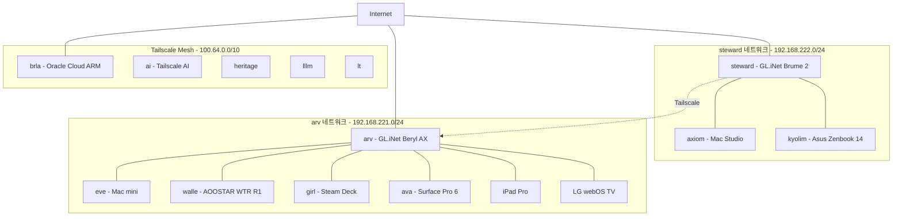

# Infrastructure Reference

호스트별 하드웨어 스펙, 네트워크 토폴로지, Application Manager 레이어 및 Git Credential 설정 레퍼런스입니다.

## Hardware

| Model | CPU | GPU | NPU | Memory | Disk |
| :--- | :--- | :--- | :--- | :--- | :--- |
| Mac Studio | Apple M1 Max (10-core) | M1 Max (32-core) | 16-core | 64GB | 512GB |
| Mac mini | Apple M4 (10-core) | M4 (10-core) | 16-core | 16GB | 256GB |
| AOOSTAR WTR R1 | Intel N100 (4C/4T) | Intel UHD (24EU) | NONE | 8GB | 2TB |
| Steam Deck | AMD Custom APU 0405 | AMD Custom GPU | NONE | 16GB | 256GB NVMe + 512GB eMMC |
| Surface Pro 6 | Intel Core i5-8250U (4C/8T) | Intel UHD 620 | NONE | 8GB | 128GB |
| Asus Zenbook 14 UX3405C | Intel Core Ultra 7 255H (16-core) | Intel Arc 140T | Intel AI Boost (13 NPU TOPS) | 32GB | 512GB |
| iPad Pro 12.9 | Apple M1 (8-core) | M1 (8-core) | 16-core | 16GB | 1TB |
| GL.iNet GL-MT3000 (Beryl AX) | MediaTek MT7981B (Cortex-A53) | Wi-Fi 6 | NONE | 512MB | 128MB NAND |
| GL.iNet GL-MT2500 (Brume 2) | MediaTek MT7981B (Cortex-A53) | NONE | NONE | 1GB | 8GB eMMC |

## Network

## Application Manager (Library 4-Layer)

1. **Layer 1 (System PM)**: brew (macOS), Nix (NixOS), apt (Debian), pacman (SteamOS)
2. **Layer 2 (SDK)**: mise (macOS, SteamOS), Nix packages (NixOS)
3. **Layer 3 (Package Manager)**: pnpm (Node), uv (Python), apm (AI Agent), npx, uvx — on-demand 실행
4. **Layer 4 (Binary)**: `~/.local/bin`

## Git Credential

`.gitconfig`는 `base/`에 공통 설정, credential helper는 각 호스트 `.gitconfig.local`에서 관리.

| 호스트 | Helper | 비고 |
| :--- | :--- | :--- |
| macOS (axiom, eve) | `store` | `~/.git-credentials` |
| Linux (walle, girl) | `store` | `~/.git-credentials` |

> 전 호스트 `core.ignoreCase = false` 통일. 최초 1회 인증 후 자동 저장.
