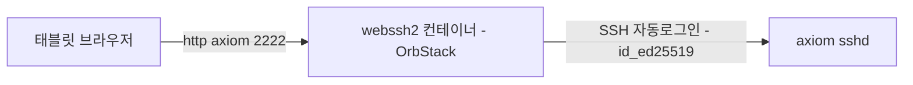

# WebSSH2 Gateway 설계 — axiom 단일 컨테이너

- [배경 및 목표](#배경-및-목표)
- [스파이크 검증 결과](#스파이크-검증-결과)
- [설계](#설계)
- [검증 계획](#검증-계획)
- [확장 절차](#확장-절차)
- [범위 외](#범위-외)

## 배경 및 목표

태블릿(Android X13 Chrome, iPad Safari)에서 브라우저 기반으로 SSH 접속하는 게이트웨이 구축. 모바일 SSH 앱은 한글 깨짐, Chrome 확장(nassh)은 태블릿 미지원으로 브라우저 게이트웨이가 유일한 경로. axiom에는 ttyd 구축이 완료돼 있으며, WebSSH2는 병행 비교 대상이다.

최종 운영 형태는 **컨테이너 1개(axiom용)**. 태블릿이 WebSSH2로 axiom에 자동로그인하고, eve 등 타 호스트는 axiom 셸 안에서 `ssh eve`(`~/.ssh/config` 별칭)로 접속한다.

## 스파이크 검증 결과

2026-11-06, `ghcr.io/billchurch/webssh2:latest`(v6.0.1) 임시 컨테이너 2개로 실측. 결정 근거가 되는 사실만 기록한다.

| 항목 | 결과 |
| :--- | :--- |
| 서버 자격증명 403 정책 | 서버 자격증명(password만으로도) 설정 시 `ssh.host` 외 호스트는 403 — 호스트당 컨테이너 필요 |
| DNS/도달성 | OrbStack 컨테이너에서 MagicDNS FQDN(`*.bun-bull.ts.net`) 해석 + TCP 22 도달 확인 |
| 브라우저 키 저장 | 개인키 paste/upload UI는 있으나 미저장 — 매 접속 재입력 (공식 문서 명시) |
| URL 파라미터 | `?host=<fqdn>&username=<user>`로 Host/Port/Username 프리필 확인 |
| 환경변수 주입 | `WEBSSH2_SSH_HOST`/`WEBSSH2_USER_*` 동작 확인 |

## 설계

### 구성

- 이미지: `ghcr.io/billchurch/webssh2:latest` (v6.0.1, arm64)
- 서비스 1개 `webssh2`: publish `2222:2222`, `restart: unless-stopped`
- config.json 마운트로 고정: `ssh.host=axiom.bun-bull.ts.net`, `user.name=crong`, `user.privateKey=<id_ed25519 전문>`
- `/data` named volume: host key 스토어 영속화 (이미지에 VOLUME 미선언 — 미마운트 시 재생성마다 소실)

### 파일/경로

| 위치 | 경로 | 내용 |
| :--- | :--- | :--- |
| repo (stow) | `axiom/.config/webssh2/docker-compose.yml` | 서비스 정의 |
| repo (stow) | `axiom/.config/webssh2/gen-hosts.sh` | config 생성 스크립트 |
| local (repo 외부) | `~/.local/share/webssh2/hosts/axiom.json` | gen 산출물 — privateKey 포함 |
| repo | `docs/okf/how-to/2026-11-06-webssh2-orbstack-setup.md` | 설치·운영 매뉴얼 |

compose의 volume은 `${HOME}` interpolation으로 local 경로를 지정한다.

### gen-hosts.sh

- 인자: `<alias> <host> <user> [keypath=~/.ssh/id_ed25519]`
- 동작: PEM 개인키를 JSON 문자열로 escape해 config.json 생성
- 사유: `user.privateKey`는 키 전문 문자열 — 수작업 JSON escape는 오류 발생 여지가 있어 스크립트로 고정

### 시크릿 정책

- repo에는 시크릿이 물리적으로 존재하지 않는다. 키의 SoT는 `~/.ssh`(수동 관리)이며 repo에 넣으면 이중 관리(DRY 위반)가 된다.
- gen 산출물은 repo 밖 `~/.local/share/webssh2/`(XDG data)에 둔다.
- 자동로그인 게이트웨이의 노출은 해당 키의 사용 권한과 동일하므로 tailnet/신뢰 LAN 전제로 운영한다.

### 운영

- OrbStack 부팅 시 restart 정책으로 자동기동
- 키 로테이션 시 gen-hosts.sh 재실행 + `docker compose restart`
- 접속 주소: `http://axiom:2222` (tailnet)

## 검증 계획

각 단계는 verify 체크포인트를 통과해야 다음으로 진행한다.

1. axiom 도달성·키 사전확인 → verify: `ssh -i ~/.ssh/id_ed25519 crong@axiom.bun-bull.ts.net` 성공 (컨테이너 경로와 동일 조건)
2. gen-hosts.sh 실행 → verify: 생성 config가 `jq` 파싱 통과 + privateKey 필드 존재
3. `docker compose up -d` → verify: `http://localhost:2222` HTTP 200
4. Playwright 터미널 진입 → verify: 프롬프트 표시 + `hostname` 출력이 axiom
5. 재시작 복구 → verify: `docker compose restart` 후 HTTP 200 + `/data` volume의 host key 유지
6. 모바일 실사용(X13 Chrome, iPad Safari) → 사용자 확인 — ttyd와의 비교 판단 기준

## 확장 절차

eve/brla 등 호스트 직접 진입이 필요해지면: `gen-hosts.sh` 1회 실행 + compose에 서비스 블록 1개 추가(포트 2223부터 순차). 403 정책상 호스트당 컨테이너가 필요하다.

## 범위 외

- Nerd Font/p10k 글리프 대응 — 기본 폰트로 시작, 모바일 비교 후 판단
- eve/brla용 컨테이너 — 확장 절차로 필요 시 추가
- WebSSH2 vs ttyd 최종 선택 — 병행 비교 후 결정
